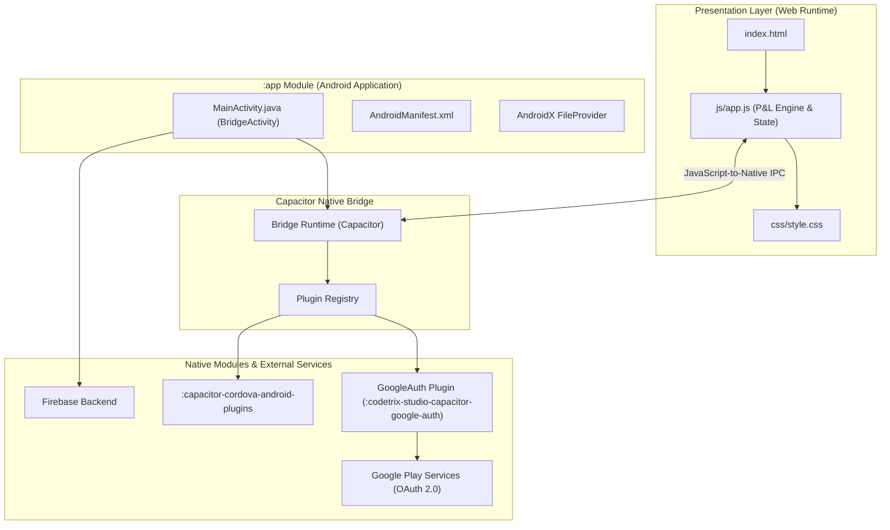
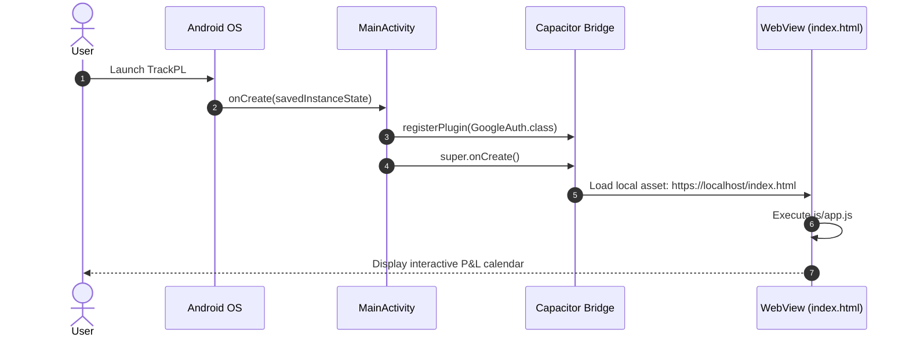
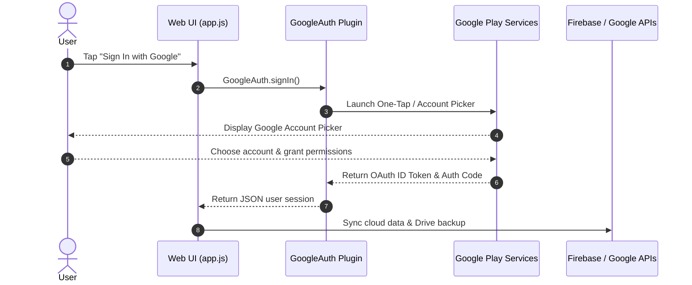

# TrackPL — System Design & Project Setup Guide

Comprehensive architectural documentation, system design specifications, and developer guide for the **TrackPL** Android project.

---

## Table of Contents

- [1. System Architecture & Design](#1-system-architecture--design)
  - [High-Level Architecture](#high-level-architecture)
  - [Layered Architecture](#layered-architecture)
  - [Execution & Sequence Flows](#execution--sequence-flows)
- [2. Detailed Project Structure](#2-detailed-project-structure)
  - [Annotated File Tree](#annotated-file-tree)
  - [Module Responsibilities](#module-responsibilities)
- [3. Native Configuration & Integrations](#3-native-configuration--integrations)
  - [Google Identity & OAuth 2.0](#google-identity--oauth-20)
  - [Firebase Integration](#firebase-integration)
  - [Deep Linking & Intent Filters](#deep-linking--intent-filters)
  - [FileProvider Configuration](#fileprovider-configuration)
  - [Centralized Dependency Management](#centralized-dependency-management)
- [4. Signing & Release Configurations](#4-signing--release-configurations)
- [5. Web Assets & Capacitor Sync Workflow](#5-web-assets--capacitor-sync-workflow)
- [6. Troubleshooting & FAQs](#6-troubleshooting--faqs)

---

## 1. System Architecture & Design

### High-Level Architecture

TrackPL follows the **Capacitor Native-Bridge Architecture**. The presentation layer is an offline-capable single-page application (SPA) running inside a hardware-accelerated Android `WebView`, communicating with native platform plugins over an asynchronous IPC bridge.



---

### Layered Architecture

1. **Presentation Layer (`app/src/main/assets/public/`)**:
   - Packaged single-page application (`index.html`, `js/app.js`, `css/style.css`).
   - Served locally via the secure `https://` scheme on `localhost` (`androidScheme: "https"`).
   - Manages interactive calendar UI, P&L calculations, local transaction cache, and UI animations.

2. **Native Host Layer (`:app`)**:
   - `MainActivity.java` extends `BridgeActivity`.
   - Initializes the Capacitor runtime and registers custom plugins on `onCreate`.
   - Manages Android activity lifecycles, window insets, orientations, and back navigation.

3. **Bridge & Plugin Layer (`:capacitor-android`, `:codetrix-studio-capacitor-google-auth`)**:
   - Translates JavaScript invocations into native Android Java calls.
   - Manages Google Play Services authentication requests and delivers OAuth tokens back to the web context.

4. **Cloud & Services Layer**:
   - **Google Identity**: Handles OAuth consent and credentials.
   - **Firebase Services**: Configured with `google-services.json` for authentication redirect routing.
   - **Google Drive API**: Uses the `https://www.googleapis.com/auth/drive.file` scope to persist user backup files.

---

### Execution & Sequence Flows

#### 1. App Startup Flow


#### 2. Google Authentication Flow


---

## 2. Detailed Project Structure

### Annotated File Tree

```
TrackPL/
├── app/                                      # Android Application Module (:app)
│   ├── build.gradle                          # Application build definitions, SDK, signing configs
│   ├── capacitor.build.gradle                # Injected plugin build configurations
│   ├── google-services.json                  # Firebase configuration and API keys
│   ├── proguard-rules.pro                    # R8 / ProGuard rules for release shrinking
│   ├── release.keystore                      # Pre-configured production release keystore
│   └── src/
│       ├── main/
│       │   ├── AndroidManifest.xml           # Activity, permissions, intent-filters, provider
│       │   ├── assets/
│       │   │   ├── capacitor.config.json     # App ID, scheme, and plugin declarations
│       │   │   ├── capacitor.plugins.json    # Plugin package classpaths
│       │   │   └── public/                   # Bundled web assets (HTML, JS, CSS)
│       │   │       ├── index.html            # Main web UI
│       │   │       ├── js/app.js             # Frontend logic & Capacitor bridge calls
│       │   │       └── css/style.css         # Styling
│       │   ├── java/com/srikanthneela/calendarapp/
│       │   │   └── MainActivity.java         # Native entry point (extends BridgeActivity)
│       │   └── res/                          # Android drawables, mipmaps, strings, XML
│       ├── androidTest/                      # Android instrumented tests
│       └── test/                             # JVM unit tests
├── capacitor-cordova-android-plugins/        # Cordova plugin compatibility module
│   ├── build.gradle
│   └── cordova.variables.gradle
├── gradle/
│   └── wrapper/
│       ├── gradle-wrapper.jar
│       └── gradle-wrapper.properties         # Configures Gradle 8.11+ / 9.x
├── build.gradle                              # Project root build script (AGP 9.5.1, GMS)
├── settings.gradle                           # Module inclusion script
├── capacitor.settings.gradle                 # Subproject paths for Capacitor modules
├── variables.gradle                          # Centralized SDK & dependency versions
├── gradle.properties                         # JVM memory flags & AndroidX settings
├── local.properties                          # Local SDK directory
├── gradlew                                   # Unix Gradle wrapper executable
└── gradlew.bat                               # Windows Gradle wrapper executable
```

### Module Responsibilities

| Sub-Project | Type | Description |
|---|---|---|
| `:app` | Android Application | Main runnable application package that bundles native code, web assets, resources, and signing configs. |
| `:capacitor-android` | Android Library | Core Capacitor Android bridge between native Android APIs and the WebView runtime. |
| `:codetrix-studio-capacitor-google-auth` | Android Library | Native Google Sign-In plugin handling Google Play Services OAuth flow. |
| `:capacitor-cordova-android-plugins` | Android Library | Backward compatibility wrapper for Cordova plugins. |

---

## 3. Native Configuration & Integrations

### Google Identity & OAuth 2.0

Configured in `app/src/main/assets/capacitor.config.json` and `app/src/main/res/values/strings.xml`:

- **Client ID**: `810108159250-h2893af8f1saj1ov41kvpa329tu196uu.apps.googleusercontent.com`
- **Configured Scopes**:
  - `profile`
  - `email`
  - `https://www.googleapis.com/auth/drive.file`
- **Native Registration** in `MainActivity.java`:
  ```java
  public class MainActivity extends BridgeActivity {
      @Override
      public void onCreate(Bundle savedInstanceState) {
          super.onCreate(savedInstanceState);
          registerPlugin(GoogleAuth.class);
      }
  }
  ```

### Firebase Integration & Environment Isolation

> [!IMPORTANT]
> **Zero Credential Leakage Policy**: Real Firebase configuration files (`google-services.json`, `firebase-config.js`) and keystore files (`*.keystore`) are strictly kept **local only** and are ignored by Git.

#### 1. Android Native Config (`app/google-services.json`)
- The Google Services Gradle plugin (`com.google.gms.google-services`) is applied conditionally in `app/build.gradle` only when `google-services.json` is physically present.
- The template file [`app/google-services.json.example`](app/google-services.json.example) is checked into version control.
- When setting up on a new environment:
  ```powershell
  copy app\google-services.json.example app\google-services.json
  # Edit app\google-services.json with your Firebase project credentials
  ```

#### 2. Web / Frontend Config (`www/js/firebase-config.js`)
- Frontend Firebase credentials are loaded dynamically at runtime via `window.FIREBASE_CONFIG` rather than being hardcoded into the source code.
- The actual configuration lives in `www/js/firebase-config.js` (untracked).
- The template file [`www/js/firebase-config.example.js`](../www/js/firebase-config.example.js) and [`.env.example`](../.env.example) provide the required configuration schema.

### Deep Linking & Intent Filters

Declared in `AndroidManifest.xml`:

1. **Firebase Auth Redirects**:
   ```xml
   <intent-filter android:autoVerify="true">
       <action android:name="android.intent.action.VIEW" />
       <category android:name="android.intent.category.DEFAULT" />
       <category android:name="android.intent.category.BROWSABLE" />
       <data android:scheme="https" android:host="trackpl-3d110.firebaseapp.com" />
   </intent-filter>
   ```

2. **Custom URL Scheme**:
   ```xml
   <intent-filter>
       <action android:name="android.intent.action.VIEW" />
       <category android:name="android.intent.category.DEFAULT" />
       <category android:name="android.intent.category.BROWSABLE" />
       <data android:scheme="com.srikanthneela.calendarapp" />
   </intent-filter>
   ```

### FileProvider Configuration

Used for secure file sharing (e.g., export/import of calendar backups):
- Authority: `${applicationId}.fileprovider`
- Paths configuration: `app/src/main/res/xml/file_paths.xml`

### Centralized Dependency Management

All SDK and library versions are maintained in `variables.gradle`:
```groovy
ext {
    minSdkVersion = 24
    compileSdkVersion = 36
    targetSdkVersion = 36
    androidxActivityVersion = '1.11.0'
    androidxAppCompatVersion = '1.7.1'
    androidxCoordinatorLayoutVersion = '1.3.0'
    androidxCoreVersion = '1.17.0'
    coreSplashScreenVersion = '1.2.0'
    androidxWebkitVersion = '1.14.0'
    junitVersion = '4.13.2'
    androidxJunitVersion = '1.3.0'
    androidxEspressoCoreVersion = '3.7.0'
    cordovaAndroidVersion = '14.0.1'
}
```

---

## 4. Signing & Release Configurations

TrackPL includes a pre-configured keystore in `app/release.keystore`:

- **Keystore Path**: `app/release.keystore`
- **Keystore Password**: `trackpl123`
- **Key Alias**: `trackpl`
- **Key Password**: `trackpl123`
- **Signature Schemes**: `v1` (JAR signing) and `v2` (Full APK signing) enabled.

Configured in `app/build.gradle`:
```groovy
signingConfigs {
    release {
        storeFile file('release.keystore')
        storePassword 'trackpl123'
        keyAlias 'trackpl'
        keyPassword 'trackpl123'
        v1SigningEnabled true
        v2SigningEnabled true
    }
}
```

---

## 5. Web Assets & Capacitor Sync Workflow

When web assets in the root workspace (`www/` or `p_l_pwa_tracker.html`) are updated:

1. Copy or build web distribution into `www/`.
2. From the root directory, run:
   ```bash
   npx cap sync android
   ```
3. This syncs `www/` into `TrackPL/app/src/main/assets/public/`.
4. Rebuild the Android project with `.\gradlew.bat :app:assembleDebug`.

---

## 6. Troubleshooting & FAQs

### 1. `Unsupported class file major version`
- **Cause**: Android Gradle Plugin 9.5+ requires Java 21.
- **Fix**: Set JDK 21 as your active JDK in terminal (`java -version`) and inside Android Studio (**Settings > Build, Execution, Deployment > Build Tools > Gradle > Gradle JDK**).

### 2. Missing `local.properties`
- **Cause**: Fresh clone on a new machine.
- **Fix**: Create a `local.properties` file in `TrackPL/` containing:
  ```properties
  sdk.dir=C\:\\Users\\<username>\\AppData\\Local\\Android\\Sdk
  ```

### 3. Google Sign-In Returns Developer Error (Code 10)
- **Cause**: The SHA-1 fingerprint of `app/release.keystore` is not registered in Firebase or Google Cloud Console.
- **Fix**: Extract the SHA-1 fingerprint using:
  ```powershell
  keytool -list -v -keystore app/release.keystore -alias trackpl -storepass trackpl123
  ```
  Add the SHA-1 fingerprint to your Android app settings in the Firebase Console.
